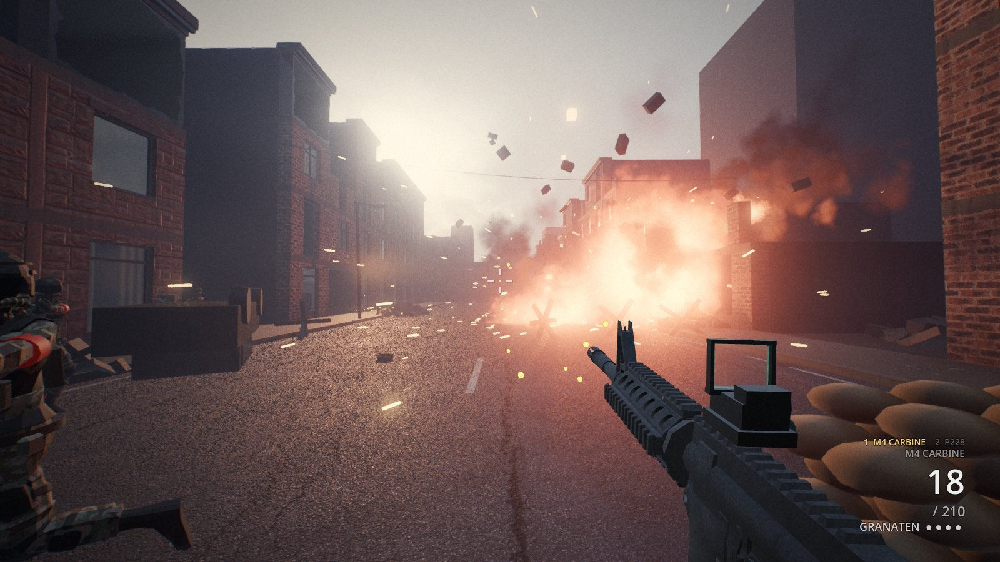
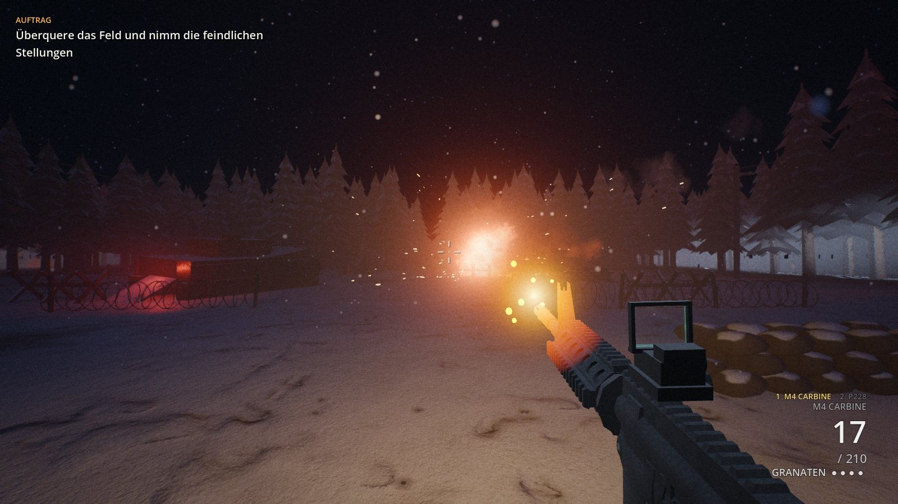
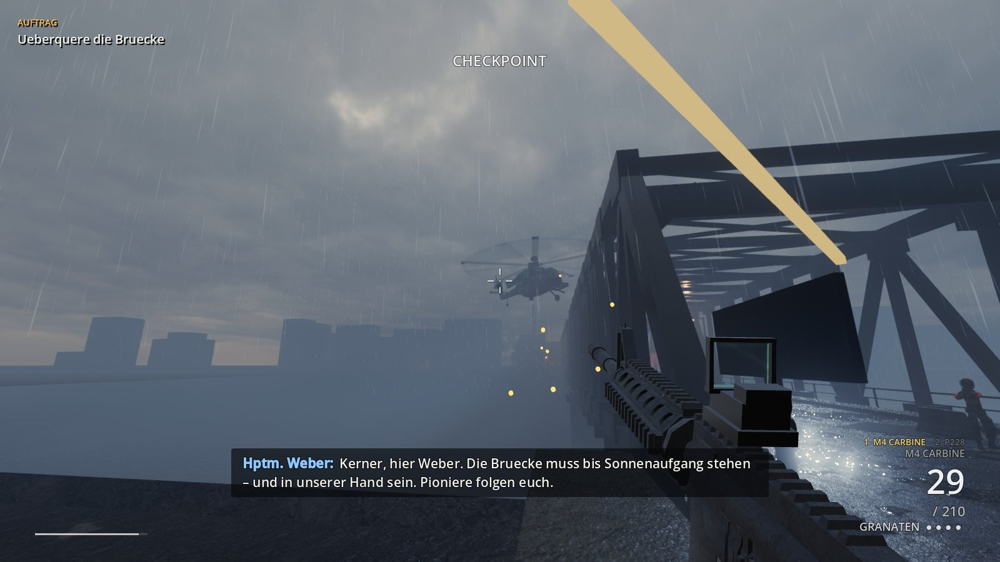
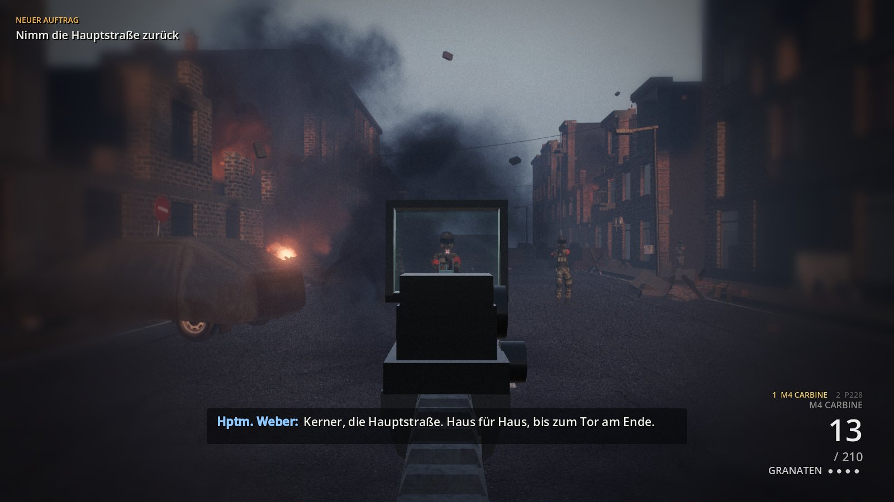
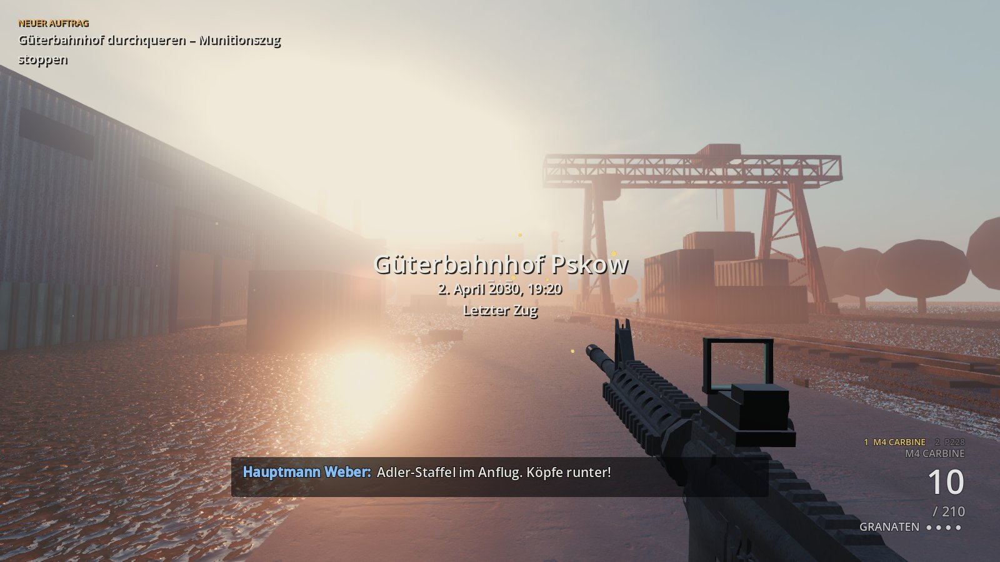
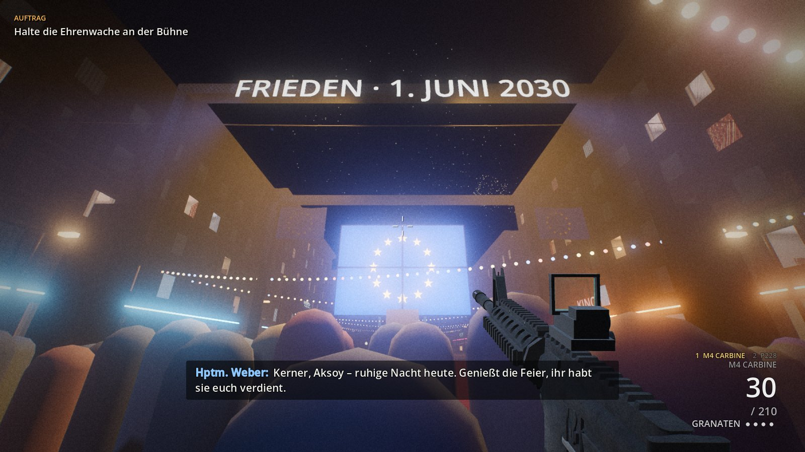
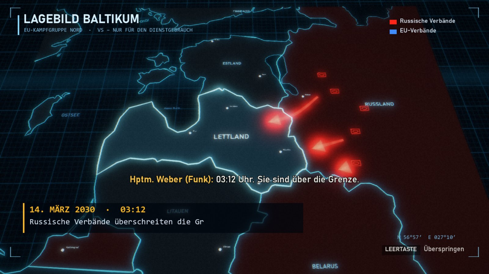

# Letztes Reich

Singleplayer-Korridorshooter in Godot 4.7. Fiktive Geschichte, Europa 2030 – 5 Missionen mit Intro.

| | |
|---|---|
|  |  |
| **Nacht an der Grenze** – Feuergefecht im verschneiten Baltikum | **Die Brücke** – Kampfhubschrauber über dem Fluss, im Regen |
|  |  |
| **Häuserkampf** – über das Reflexvisier in der Ruinenstraße | **Letzter Zug** – Güterbahnhof Pskow im Abendlicht |
|  |  |
| **Das letzte Reich** – Friedensfeier in Berlin … | **Intro** – Lagebild Baltikum, 14. März 2030, 03:12 Uhr |

## ▶ Spielen

1. **[Neueste Version herunterladen](https://github.com/DerAlo/letztes-reich/releases/latest)** – `LetztesReich-v0.1-win64.zip` (~510 MB)
2. Entpacken, `LetztesReich.exe` doppelklicken. Keine Installation nötig.
3. Falls Windows warnt („Der Computer wurde durch Windows geschützt“): **Weitere Informationen → Trotzdem ausführen** (die Datei ist nicht signiert).

**Voraussetzungen:** Windows 10/11 64-Bit, Vulkan-fähige Grafikkarte (etwa GTX 1060 / RX 580 oder besser).

## Steuerung

| Taste | Aktion |
|---|---|
| W A S D / Maus | Bewegen / Umsehen |
| Linksklick / Rechtsklick | Schießen / Zielen |
| Shift | Sprinten |
| Leertaste | Springen, an Kanten hochklettern |
| C (lang: hinlegen), Z | Ducken, Hinlegen |
| Shift + C | Rutschen |
| R / G / E | Nachladen / Granate / Benutzen |
| 1 / 2, Mausrad, Q | Gewehr / Pistole, Waffe wechseln, letzte Waffe |
| Esc | Pause (Intro: Leertaste/Esc überspringt) |

## Entwicklung

Projekt in Godot 4.7.2 öffnen (`project.godot`). Export: Preset „Windows“ (eine .exe mit eingebettetem PCK).

Alle Figuren, Organisationen und Symbole sind frei erfunden. Freie Assets und Lizenzen: [assets/CREDITS.md](assets/CREDITS.md).
